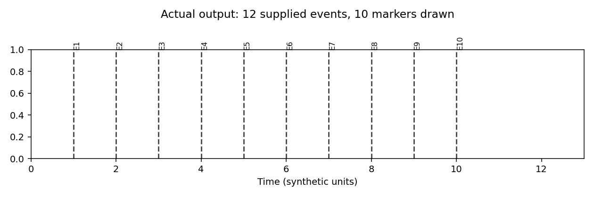

# Comenius: bug evidence and Box setup

**Review date:** 17 September 2026. **Code reviewed:** [`2976d2763d8a42d4daa104551a3cb10e17198563`](https://github.com/emelon8/experiment_analysis/commit/2976d2763d8a42d4daa104551a3cb10e17198563), the fetched `proj-comenius` head.

## Findings that need attention first

1. **Make Box download completion trustworthy before importing recordings.** Interrupted, incomplete, or partially listed downloads can be reported as successful. These are synthetic reproductions, not evidence that existing lab recordings are damaged.
2. **Resolve the statistics frequency mismatch before trusting runs with overrides.** The real pipeline logs 10–30 Hz, applies 0.5–4 Hz in the real filter, then records the subject as completed.
3. Fix the spectrogram crash, then the remaining error reporting and legacy workflow defects below.

**Result: 12 failing probes, 9 passing controls, 6.35 seconds.** Failures are intentional evidence of outstanding defects. Production source was not changed. These tests exercise legacy Python paths and EVC; they do not establish that every defect is reachable through the new workbench.

## Evidence index

| Issue | Trigger | Actual result | Scope / control |
|---|---|---|---|
| [#109](https://github.com/emelon8/experiment_analysis/issues/109) | Compute a miniscope spectrogram with plotting enabled | `TypeError: 'bool' object is not callable` at postprocessor line 323 | Actual imported method; transform stubbed. Disabling plotting succeeds. |
| [#110](https://github.com/emelon8/experiment_analysis/issues/110) | Pipeline frequency override 10–30 Hz; StatsConfig defaults 0.5–4 Hz | Log: 10–30; both actual segment filters: 0.5–4; subject marked complete | Real pipeline, loader orchestration, slicing, filtering, and log writer. Disk readers and TTL alignment simulated; downstream metrics stubbed. Matching config and default-band controls pass. Runtime proof covers ephys/calcium coherence; scatter has the same config usage by inspection. |
| [#111](https://github.com/emelon8/experiment_analysis/issues/111) | Successful synthetic scatter subject reaches population summary | `'list' object has no attribute 'items'`; no summary PNG; run reports 1 completed, 0 skipped | Real pipeline, collector, summary function; subject stats supplied by fixture. Calling the same summary with a mapping writes its figure. |
| [#112](https://github.com/emelon8/experiment_analysis/issues/112) | CLI receives an explicit nonexistent config path | Exit 0, banner only, no error | Actual subprocess; `--help` succeeds as a control. |
| [#113](https://github.com/emelon8/experiment_analysis/issues/113) | Cancel or close the crop dialog | All-zero coordinates; real crop operation changes `(2, 8, 10)` movie to `(2, 0, 0)` | Actual dialog event logic with simulated UI window; actual array slicing. Full-frame control preserves the movie. No desktop click test. |
| [#114](https://github.com/emelon8/experiment_analysis/issues/114) | Record an EVC revision with raw files at the workspace root | `.ncs`, `.nev`, `.tif`, `.npy` fixtures appear in the snapshot | Real EVC record/show using tiny placeholder bytes. Same files under `artifacts/` are excluded. Does not measure large-file performance. |
| [#115](https://github.com/emelon8/experiment_analysis/issues/115) | Supply 12 event labels and timestamps | Only 10 markers drawn | Real Matplotlib plot; ten-event control passes. This is an explicit limit in the current implementation, not a newly established regression. |

### Box findings

All four use the **actual imported downloader/verification functions**, temporary directories, and a fake Box client. No network or credentials are involved.

| Probe | Exact observation | Cause and proposed acceptance |
|---|---|---|
| Interrupted transfer → retry | First call returns false after writing `PART`; retry returns true, makes zero download calls, leaves `PART` | Existing filenames are skipped. Use partial-file staging, integrity validation, and atomic promotion; retry must obtain complete bytes. |
| Failed child folder | Child listing raises an error; root still returns true | Recursive result is discarded. Propagate failure and identify incomplete items. |
| Two-page listing | Response advertises another page; only one listing call; `second.ncs` absent; result true | Pagination is absent. Retrieve all pages before declaring completion. |
| Nonempty incomplete folder | Folder containing only `README.txt` is verified true | Nonempty-directory check cannot establish recording completeness. Verify required files against a reviewed manifest. |

A clean one-file download passes, distinguishing transfer failure handling from a universal inability to write files. Box documents that paginated listings require continuing through the returned marker: [official pagination guide](https://developer.box.com/guides/api-calls/pagination/marker-based/).

### Hypotheses and outcomes

- **Box:** existing-file shortcut, unconsumed pagination, and discarded recursive failure each reproduce independently. Clean-download control succeeds.
- **Frequency mismatch:** the explicit range reaches the loader and log; the analysis engine still reads the original StatsConfig. The loader requests `filter_type=None`, ruling out an intended loader bandpass as the explanation at this boundary. Updating only the fixture's StatsConfig to match the requested band makes the probe pass. The alternative “only the log is wrong” does not fit the pipeline's documented override precedence.
- **Summary figure:** retaining the mapping makes the actual summary function work. The missing output is attributable to the caller's list conversion, not the output directory or image backend.

## Review the proof

- [Complete captured output](proof-output.txt)
- [Reproduction probes and declared substitutions](test_bug_proofs.py)
- [Runner](run_proofs.sh)

From the repository root, with scientific dependencies installed:

```bash
PROOF_PYTHON=/path/to/scientific/python bash review/2026-09-17/run_proofs.sh
```

On the investigated machine the interpreter is `/home/reedpen/.conda/envs/caiman/bin/python`. It uses Python 3.10.21, NumPy 2.2.6, SciPy 1.15.2, Matplotlib 3.10.9, pytest 9.1.1, CaImAn 1.13.2, and box_sdk_gen 1.17.0. Source imports come from this checkout. The runner returns a nonzero status while bugs remain; these review probes are outside the normal `tests/` discovery path. They are diagnostic artifacts, not a proposal to merge permanently failing CI tests.



## Box: ready for the account-specific step

**Status: not connected yet.** The user already has a Box developer app. Its authentication type, local credential-file location, and target lab folder are still needed. No real credentials have been read or saved and no recording has been downloaded.

The existing project template uses Client Credentials Grant (CCG). We should use the existing app's actual authentication method; creating a client object is not evidence of access. The [Box authentication guide](https://github.com/box/box-python-sdk/blob/main/docs/authentication.md) documents separate CCG and JWT flows. Enterprise server apps require authorization; user authentication also depends on access settings. [Official CCG setup](https://developer.box.com/guides/authentication/client-credentials/client-credentials-setup/).

The prepared [access checker](check_box_access.py) makes only identity, folder-metadata, and one-item folder-listing requests. It prints the authenticated identity and folder, suppresses potentially sensitive exception details, and saves no credentials. It does not test download permission or configure the legacy downloader.

Run one of these locally, using the lab's numeric folder ID:

```bash
# CCG: enter the client secret privately at the hidden prompt
python review/2026-09-17/check_box_access.py --ccg-prompt --folder-id FOLDER_ID

# Or read an existing private JSON file; do not put secret contents in chat
python review/2026-09-17/check_box_access.py --ccg-config /private/path/ccg.json --folder-id FOLDER_ID
python review/2026-09-17/check_box_access.py --jwt-config /private/path/box-jwt.json --folder-id FOLDER_ID
```

Use the scientific interpreter above if the default `python` lacks the Box SDK. CCG JSON keys are `client_id`, `client_secret`, and exactly one of `user_id` or `enterprise_id`; JWT uses Box's downloaded JSON unchanged. Temporary tokens can be checked with `--token-prompt`, but this is not durable OAuth configuration. Shared `/s/` links require resolving access separately; the checker expects an accessible `/folder/ID` folder.

Checker validation completed: help/parser runs, installed CCG SDK construction with synthetic values, and SDK method signatures checked. **Live account access and JWT authentication remain unverified.**

## Human decisions still needed

- **Box identity and boundary:** which existing identity should access which lab folder? First verify listing; then choose one small recording for an integrity-checked transfer. GUI integration remains [#85](https://github.com/emelon8/experiment_analysis/issues/85), with transfer policy in [#105](https://github.com/emelon8/experiment_analysis/issues/105).
- **Frequency precedence:** confirm that an explicit per-run override is authoritative, as the pipeline currently documents. Log exactly the settings passed to every analysis stage.
- **Cancel behavior:** abort the crop step or retain the original full frame. Either requires changing the cancellation contract; zero-area processing is the observed defect.
- **Raw-data history:** require raw data under `artifacts/`, expand ignore rules, or both. Broad `.npy` exclusion could also hide small derived results, so this needs an explicit policy.
- **Event display:** all events, user-event filtering, or an obvious selectable limit. Avoid silently hiding event 11 onward.

These choices remain open for human review. No issue has been closed as fixed by this investigation.
